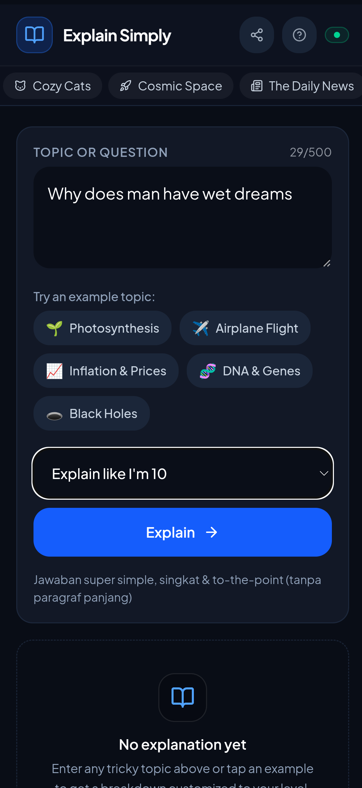
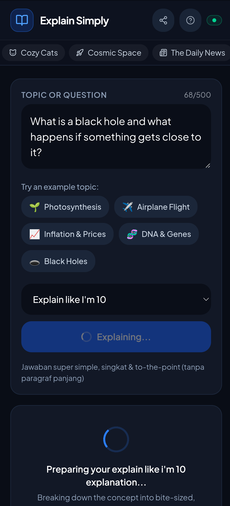
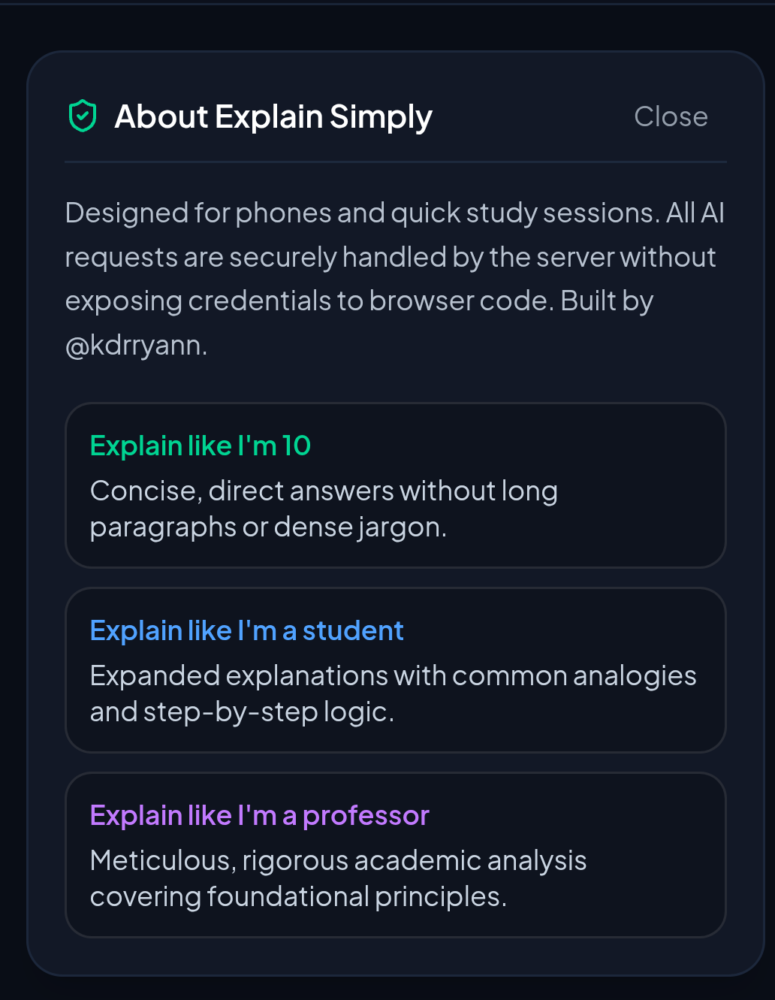

<div align="center">
  

# Explain Simply
</div>

An AI web app powered by Google Gemini that explains hard topics in simple, clear language. You choose the depth: **Explain like I'm 10**, **like I'm a student**, or **like I'm a professor**. Answers come back in the same language as your question.

## Screenshots

<div align="center">
  
  
  
</div>

## Tech Stack

- **Frontend:** React 19, TypeScript, Vite, Tailwind CSS 4
- **Backend:** Node.js, Express (local) and Vercel Serverless Functions (production)
- **AI:** Google Gemini (`@google/genai`)
- **Hosting:** Vercel

## How the App Works

1. The user types a question and picks an explanation level.
2. The frontend sends the question to the backend at `/api/explain`.
3. The backend picks a system prompt that matches the level and sends it to Gemini together with the question.
4. Gemini returns the explanation in Markdown, and the app shows it on screen.

The API key lives only on the server, so it's never exposed to the browser.

## How the API Works

### `POST /api/explain`

```json
{ "question": "What is a black hole?", "level": "simple" }
```

- `level`: `simple` | `intermediate` | `detailed`
- The backend tries several lightweight Gemini models in order. If one model fails or runs out of quota, it automatically moves on to the next one.
- It supports up to 5 API keys (`GEMINI_API_KEY` to `GEMINI_API_KEY_5`), and it rotates to the next key when one runs out.

### `GET /api/status`

Shows whether the AI is configured and how many keys are active.

## Manual Deployment

### Run locally

```bash
git clone https://github.com/kdrryan/Explain-Simply.git
cd Explain-Simply
npm install
cp .env.example .env
```

Add your key to `.env` (get one at [Google AI Studio](https://aistudio.google.com/apikey)):

```env
GEMINI_API_KEY="your_gemini_api_key"
```

```bash
npm run dev
```

Open `http://localhost:3000`.

### Deploy to Vercel

1. Fork this repo and import it at [vercel.com/new](https://vercel.com/new).
2. Add `GEMINI_API_KEY` under **Settings → Environment Variables**.
3. Click **Deploy**. `vercel.json` already sets up the build and the `/api` routes.

## Author

 [@kdrryann](https://github.com/kdrryan)
